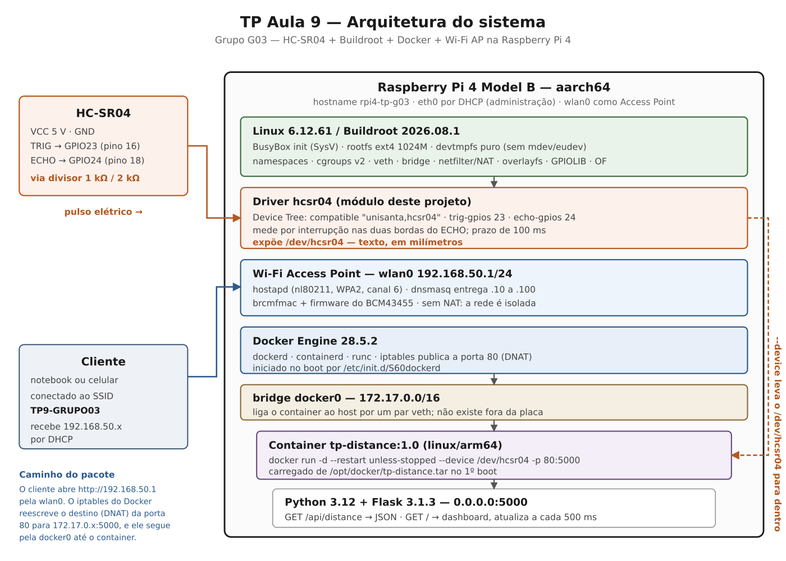

# TP Aula 9 — HC-SR04 + Buildroot + Docker + Wi-Fi AP na Raspberry Pi 4

**Disciplina:** Sistemas Embarcados · Engenharia de Computação · UNISANTA

**Professor:** Sergio Schina · Grupo 3

| Integrante      | RA     |
|-----------------|--------|
| Pedro Cretella  | 226013 |
| Pedro Brito     | 226146 |
| Vinícius Regis  | 230610 |
| Rafael Lima     | 226326 |

## Objetivo

Construir, com o Buildroot, uma imagem Linux embarcada para a Raspberry Pi 4 que, ao ser ligada:

1. carregue um **driver de kernel próprio** para o sensor ultrassônico HC-SR04, que expõe a
   medição em `/dev/hcsr04`, em milímetros;
2. suba uma **rede Wi-Fi própria**, em modo Access Point, com SSID `TP9-GRUPO03` e endereço
   `192.168.50.1`;
3. inicie o **Docker** e um **container** com a aplicação Flask, recebendo o device por `--device`;
4. sirva um **dashboard** em `http://192.168.50.1` que mostra a distância em tempo real,
   atualizando a cada 500 ms.

Tudo **sem nenhum comando manual** após o boot e **sem acesso à internet**: a imagem do container
viaja dentro do cartão, e o dashboard não busca nada de fora.

O caminho completo — do eco ultrassônico até o número na tela — está em
[docs/arquitetura.md](docs/arquitetura.md).

## Hardware utilizado

| Item | Descrição |
|---|---|
| Placa | Raspberry Pi 4 Model B |
| SoC | Broadcom BCM2711, Cortex-A72 quad-core, AArch64 |
| Wi-Fi | Broadcom BCM43455, onboard, via SDIO |
| Sensor | HC-SR04 (ultrassônico, 5 V), em protoboard |
| Adequação de nível | divisor resistivo 1 kΩ / 2 kΩ no pino ECHO — **obrigatório** |
| Armazenamento | cartão microSD (mínimo 2 GB; a imagem ocupa 1,1 GB) |
| Console | monitor HDMI e teclado USB |
| Cliente | notebook ou celular, para conectar ao Wi-Fi da placa |
| Host de build | PC x86_64 com Linux, ~30 GB livres, Docker e emulação ARM64 |

A ligação pino a pino e o cálculo do divisor estão em [docs/hardware.md](docs/hardware.md).

## Versões

| Item | Valor |
|---|---|
| Buildroot | **2026.08.1** |
| Defconfig base | `raspberrypi4_64_defconfig` |
| Arquitetura | AArch64 (Cortex-A72), toolchain externa Bootlin glibc |
| Kernel | Raspberry Pi Linux 6.12.61 (`bcm2711_defconfig`) + `linux-docker.fragment` |
| Init | BusyBox init (SysV) |
| Driver | `hcsr04`, deste projeto, compilado como módulo externo |
| Wi-Fi AP | hostapd 2.12 · dnsmasq 2.93 · iw 6.17 |
| Firmware | linux-firmware 20260810 · wireless-regdb 2026.09.03 |
| Docker | docker-engine 28.5.2 + docker-cli 28.5.2 (pacotes Buildroot) |
| Container | `tp-distance:1.0` · `linux/arm64` · base `python:3.12.15-slim-bookworm` |
| Aplicação | Flask 3.1.3 sobre Python 3.12 |
| Rootfs | ext4, 1024 MB (269 MB ocupados) |

## Arquitetura do sistema



```
HC-SR04 → GPIO23/24 → driver hcsr04 → /dev/hcsr04 → --device → Flask → navegador
                                                                  ↑
                                                         Wi-Fi AP 192.168.50.1
```

O cliente conecta ao SSID da própria placa e acessa `http://192.168.50.1`. O `iptables` que o
Docker gerencia reescreve o destino (DNAT) da porta 80 da Raspberry para o IP interno do container
na bridge `docker0`, que não existe fora da placa.

A sequência de boot está em [docs/imagens/boot.png](docs/imagens/boot.png).

## Documentação técnica

| Documento | Assunto |
|---|---|
| [docs/arquitetura.md](docs/arquitetura.md) | camadas, caminho da medição, boot, decisões estruturais |
| [docs/hardware.md](docs/hardware.md) | ligação do HC-SR04, divisor do ECHO, escolha dos GPIOs |
| [docs/driver.md](docs/driver.md) | algoritmo do driver, Device Tree, integração ao Buildroot |
| [docs/buildroot.md](docs/buildroot.md) | cada opção: símbolo, motivo, dependências, impacto; kernel |
| [docs/wifi-ap.md](docs/wifi-ap.md) | hostapd, dnsmasq, firmware do Wi-Fi, IP e DHCP |
| [docs/docker-web.md](docs/docker-web.md) | Docker, `--device`, rede, API e dashboard |
| [docs/compilacao.md](docs/compilacao.md) | reconstrução do zero, tempos, conferências |
| [docs/testes.md](docs/testes.md) | o que está conferido, o que falta validar, evidências |

### Onde está cada item exigido

A seção 13 do enunciado lista a documentação obrigatória. Esta tabela diz onde cada item está:

| Item exigido | Onde |
|---|---|
| Integrantes e RAs | este README, no topo |
| Versão do Buildroot | este README, em *Versões* |
| Diagrama completo da arquitetura | [docs/arquitetura.md](docs/arquitetura.md) e `docs/imagens/` |
| Esquema elétrico, com divisor do ECHO | [docs/hardware.md](docs/hardware.md) |
| Justificativa de GPIO23 e GPIO24 | [docs/hardware.md](docs/hardware.md) |
| Algoritmo do driver | [docs/driver.md](docs/driver.md) |
| Device Tree e campo `compatible` | [docs/driver.md](docs/driver.md) |
| `Config.in`, `.mk`, `Makefile`, `kernel-module` | [docs/driver.md](docs/driver.md) |
| Opções do kernel e do Buildroot | [docs/buildroot.md](docs/buildroot.md) |
| hostapd, dnsmasq, IP e DHCP | [docs/wifi-ap.md](docs/wifi-ap.md) |
| Rede Docker e `--device` | [docs/docker-web.md](docs/docker-web.md) |
| API do backend | [docs/docker-web.md](docs/docker-web.md) |
| Fluxo de atualização do frontend | [docs/docker-web.md](docs/docker-web.md) |
| Procedimento de compilação | [docs/compilacao.md](docs/compilacao.md) e abaixo |
| Procedimento de gravação da imagem | abaixo, em *Gravação do microSD* |
| Procedimento de teste | [docs/testes.md](docs/testes.md) |
| Problemas encontrados e soluções | abaixo |
| Hashes dos artefatos finais | [evidence/hashes.txt](evidence/hashes.txt) |

## Estrutura do repositório

```
tp.env                                  parâmetros do grupo (hostname, usuário, senhas, integrantes)
VERSION                                 identificação da versão (gerado)
README.md                               este documento
docs/                                   documentação técnica e diagramas
buildroot-config/                       cópia da defconfig (gerada) + README
flask-app/                              aplicação
├── app.py                              API /api/distance e dashboard
├── templates/index.html                frontend, tudo embutido
└── Dockerfile · requirements.txt       imagem arm64
scripts/                                automação do build (00 a 05 + lib.sh)
evidence/                               evidências
├── hardware/ login/ driver/            capturas da placa
├── network/ docker/ web/ reboot/
├── build/                              conferências feitas pelos scripts no host
└── hashes.txt                          SHA-256 dos artefatos do último build
br2-external/                           árvore BR2_EXTERNAL (name: TP)
├── external.desc · Config.in · external.mk
├── configs/tp_rpi4_defconfig           configuração Buildroot do TP (canônica)
├── package/hcsr04-driver/              pacote do driver: Config.in, .mk, src/
└── board/tp/rpi4/
    ├── buildroot.fragment              opções do TP sobre a defconfig da Pi
    ├── identidade.fragment             hostname e senha de root (gerado do tp.env)
    ├── users_table.txt                 usuário do projeto (gerado do tp.env)
    ├── linux-docker.fragment           opções de kernel para containers
    ├── hcsr04-overlay.dts · .dtbo      Device Tree do sensor
    ├── config_tp.txt                   config.txt da partição de boot
    ├── post-build.sh · post-image.sh   ajustes no rootfs e na partição de boot
    └── rootfs-overlay/
        ├── etc/issue                   banner exibido antes do login
        ├── etc/network/interfaces      eth0 por DHCP
        ├── etc/hostapd.conf            SSID, canal e WPA2 do Access Point
        ├── etc/dnsmasq.conf            faixa DHCP entregue aos clientes
        ├── etc/modules-load.d/tp.conf  módulos carregados no boot
        ├── etc/init.d/S55hcsr04        prepara o /dev/hcsr04
        ├── etc/init.d/S70tp-ap         wlan0, hostapd e dnsmasq
        ├── etc/init.d/S99tp-app        sobe o container
        ├── usr/bin/tp-evidencias       coleta as evidências na própria Pi
        └── opt/docker/                 recebe o tp-distance.tar (fora do Git)
```

A organização difere do esqueleto sugerido no enunciado em dois pontos, ambos permitidos pela
cláusula de adaptação: a árvore externa chama-se `br2-external/` e não `br2-external-tp9/`, com o
board em `board/tp/rpi4/`; e os scripts são seis, um por etapa. O motivo de a nomenclatura não
levar o número do TP está em [docs/arquitetura.md](docs/arquitetura.md).

### O que não é versionado

| Fora do Git | Motivo |
|---|---|
| `buildroot/`, `output-rpi4/`, `*.img` | artefatos de build, reconstruídos pelos scripts |
| `tp-distance.tar` (48 MB) | artefato de build; o que o define (`Dockerfile`, `app.py`, `templates/`, `requirements.txt`) está versionado |
| `.o`, `.ko` e dependências dentro do pacote do driver | o build out-of-tree do kernel os grava ao lado do fonte |

O SHA-256 dos artefatos fica em [evidence/hashes.txt](evidence/hashes.txt). Esse arquivo é
reescrito pelos scripts a cada build, então descreve **o último build feito neste repositório**.
Os hashes da imagem entregue no TP 8 estão preservados na branch `entrega-tp8` e na tag
`tp8-final` — veja "Entrega anterior", no fim deste README.

Build de Docker não é reprodutível byte a byte, então o hash identifica **aquele** artefato, não
valida uma reconstrução.

## Procedimento de configuração

Todo parâmetro do grupo está no `tp.env`:

```sh
GRUPO="G03"
INTEGRANTES=( "Pedro Cretella - RA 226013" ... )
HOSTNAME_RPI="rpi4-tp-g03"
USUARIO="aluno"
SENHA="tpgrupo03"
ROOT_SENHA="123456"
BUILDROOT_VERSION="2026.08.1"
VERSAO_PROJETO="1.0"
```

Depois de editar, `./scripts/02-configure.sh` regenera o `/etc/issue`, o `users_table.txt`, o
`identidade.fragment`, o `VERSION` e a defconfig — e falha se recarregar a defconfig salva não
reproduzir o mesmo `.config`.

O SSID, a senha do Wi-Fi e a faixa DHCP ficam em `rootfs-overlay/etc/hostapd.conf` e
`etc/dnsmasq.conf`; o `02` confere que as linhas obrigatórias continuam lá.

## Procedimento de compilação

```bash
./scripts/00-setup-host.sh        # dependências, Docker, buildx, emulação arm64 (usa sudo)
./scripts/01-fetch-buildroot.sh   # Buildroot 2026.08.1 em ./buildroot
./scripts/02-configure.sh         # gera e salva br2-external/configs/tp_rpi4_defconfig
./scripts/03-build-flask-image.sh # imagem arm64 → rootfs-overlay/opt/docker/tp-distance.tar
./scripts/04-build-image.sh       # make → output-rpi4/images/sdcard.img
```

Os scripts `02` e `03` podem rodar em qualquer ordem entre si, mas os dois precisam rodar antes do
`04`. Equivalente manual:

```bash
cd buildroot
make O=../output-rpi4 BR2_EXTERNAL=../br2-external tp_rpi4_defconfig
make O=../output-rpi4 BR2_EXTERNAL=../br2-external -j$(nproc)
```

Primeiro build: cerca de 30 minutos em 20 núcleos. Rebuild incremental: menos de um minuto.
Detalhes em [docs/compilacao.md](docs/compilacao.md).

## Gravação do microSD

```bash
./scripts/05-flash-sd.sh
```

O script lista os discos, pede o nome do dispositivo, recusa o disco do sistema e qualquer
dispositivo maior que 256 GB, exige a digitação do nome uma segunda vez e só então executa o `dd`.
Também se recusa a gravar uma imagem que não contenha o tar do container, ou cujo hash não seja o
registrado em `evidence/hashes.txt`.

Depois de gravar, **lê o cartão de volta** e compara com a imagem, registrando o resultado em
`evidence/build/cartao-gravado.txt`. É o que garante que o hash do commit descreve o cartão
apresentado.

Alternativa gráfica: Raspberry Pi Imager ou balenaEtcher, escolhendo `output-rpi4/images/sdcard.img`
como imagem personalizada.

## Usuário configurado

| Usuário | Senha | Grupos | Como nasce |
|---|---|---|---|
| `aluno` | `tpgrupo03` | `aluno`, `docker` | `users_table.txt` → `/etc/passwd`, `/etc/shadow` (SHA-256), `/etc/group` |
| `root` | `123456` | — | `BR2_TARGET_GENERIC_ROOT_PASSWD` |

Pertencer ao grupo `docker` é o que permite ao `aluno` usar a CLI sem `root`. O `=` na users table
indica senha em texto claro, que o `mkusers` converte em hash — aceitável apenas neste TP.

## Como iniciar o sistema

1. Montar o circuito e **conferir a ligação antes de energizar** — 5 V no GPIO danifica a placa.
2. Cartão gravado no slot da Raspberry.
3. Monitor HDMI e teclado.
4. Fonte de alimentação **por último**.

Ao ligar, o banner do grupo aparece antes do `login:`. Entre com `aluno` / `tpgrupo03`.

> **No primeiro boot, a tela fica parada por 1 a 2 minutos** na mensagem
> `[TP] carregando imagem Docker`. É o `docker load` dos 48 MB, que acontece uma única vez.
> Não desligue a placa nesse momento.

## Como verificar cada camada

```sh
# driver e sensor
lsmod | grep hcsr04
ls -l /dev/hcsr04
cat /dev/hcsr04              # distância em milímetros

# Wi-Fi AP
ip addr show wlan0           # tem de mostrar 192.168.50.1
hostapd_cli all_sta          # clientes associados

# Docker e container
docker ps                    # tp-distance "Up"
docker inspect tp-distance   # device, publicação da porta, IP interno

# aplicação, da própria placa
curl http://127.0.0.1/api/distance
```

Do cliente: conectar ao Wi-Fi **`TP9-GRUPO03`** (senha `embarcados2026`) e abrir
**`http://192.168.50.1`**.

O comando `tp-evidencias`, já instalado, roda quase toda essa lista de uma vez e grava em
`~/evidencias-tp.txt`.

> A rede do AP **não tem internet** — não há NAT, de propósito. Um celular com dados móveis
> ligados pode sair da rede por isso. Use o notebook, ou desligue os dados móveis antes.

## Evidências

**O sistema ainda não foi validado em hardware.** O que existe hoje é verificação de build: cada
camada é conferida automaticamente no host a cada compilação, lendo o artefato real. O que isso
cobre, e o que só a placa demonstra, está separado em [docs/testes.md](docs/testes.md), junto com a
lista das doze evidências a coletar e o nome do arquivo de cada uma.

As conferências automáticas ficam em [evidence/build/](evidence/build/):

- [usuarios-na-imagem.txt](evidence/build/usuarios-na-imagem.txt) — `/etc/passwd` e `/etc/group`
  lidos de dentro do `rootfs.ext4` com `debugfs`;
- [kernel-check-config.txt](evidence/build/kernel-check-config.txt) — o `check-config.sh` do
  próprio Docker rodado contra o `.config` do kernel gerado;
- [boot-na-imagem.txt](evidence/build/boot-na-imagem.txt) — a sequência de scripts de init, os
  módulos carregados no boot e o `docker run` do container, lidos da imagem.

## Problemas encontrados e soluções adotadas

### No guia do TP, que não funcionariam nesta configuração

| Problema | Solução |
|---|---|
| O guia manda copiar `config_4.txt` para o `config.txt` da partição de boot, que é a variante de **32 bits**: a imagem não daria boot | copiamos `config_4_64bit.txt`, com `kernel=Image` e `arm_64bit=1`; o `02` confere as três linhas obrigatórias |
| O `/etc/network/interfaces` do guia **apaga a `eth0`** e declara `auto wlan0`, o que faz o `ifup` falhar no boot, porque a interface só existe depois de o firmware carregar | a `wlan0` é configurada pelo `S70tp-ap`, como o próprio script do guia faz; a `eth0` continua por DHCP |
| O guia não menciona carregar o `brcmfmac` nem o `hcsr04`. Sem `mdev`/`eudev` ninguém trata o uevent, e nem a `wlan0` nem o `/dev/hcsr04` existiriam | os dois módulos entram em `/etc/modules-load.d/tp.conf`, carregado pelo `S11modules` |
| O pacote `dnsmasq` instala um `S80dnsmasq` próprio, que subiria uma segunda instância | um `post-build.sh` do TP remove o script; quem sobe o AP inteiro é o `S70tp-ap` |
| O `COPY templates` do Dockerfile do guia não funcionaria: o `.dockerignore` do projeto é uma lista de exceções | `templates/` liberado explicitamente |

### Encontrados em revisão, antes de quebrarem

Todos só apareceriam com a placa na mesa, depois de horas de build.

| Problema | Solução |
|---|---|
| O `.dtbo` não chegava à partição de boot: `BR2_PACKAGE_RPI_FIRMWARE_EXTRA_FILES` instala na raiz de `rpi-firmware/`, mas o firmware procura em `overlays/` | `post-image.sh` próprio, listado **antes** do da Raspberry, que é quem chama o `genimage` |
| Mudar `BR2_PACKAGE_RPI_FIRMWARE_CONFIG_FILE` **não** reinstala o pacote: o `config.txt` da imagem ficou sem o `dtoverlay=hcsr04`, com o build terminando em sucesso | o `04` confere as linhas dentro da imagem, e a mensagem de erro ensina o `rpi-firmware-reinstall` |
| O firmware do Wi-Fi chega por symlink que o pacote só cria **se o alvo existir, em silêncio se não** | o `04` testa com `test -f`, que segue o link |
| O submódulo de fabricante do BCM43455 é o `brcmfmac-wcc`, não o `cyw` — a primeira versão da conferência guardava o módulo errado | corrigido conferindo a tabela SDIO no fonte do kernel |
| Uma conferência do `04` passava mesmo com o defeito presente: o `grep` casava com a palavra dentro de um comentário do próprio script | o `grep` passou a ignorar comentários; descoberto ao **sabotar** a conferência e vê-la não falhar |
| Um container criado por uma imagem anterior seria reaproveitado com as opções antigas, sem o `--device` | o `S99tp-app` confere o device do container existente e recria se faltar |
| O rename do container deixaria um tar de 48 MB esquecido dentro da imagem, carregado junto no boot | o `04` exige que `/opt/docker` contenha exatamente o tar atual e o LEIA-ME |

### Herdados do TP anterior, já tratados

| Problema | Solução |
|---|---|
| rootfs padrão da Pi tem 120 MB, insuficiente para Docker | `BR2_TARGET_ROOTFS_EXT2_SIZE="1024M"` |
| Host x86_64 geraria imagem amd64 → `exec format error` na Pi | `docker buildx --platform linux/arm64` e checagem de `arm64/linux` no `03` |
| O `S99` podia rodar antes de o `dockerd` responder | laço de espera em `docker info`, até 60 tentativas |
| O `/etc/network/interfaces` do overlay sobrescrevia o gerado, perdendo a espera pelo link da `eth0` | o arquivo do overlay contém as diretivas completas, e o `04` confere a espera na imagem |

## Limitações conhecidas

- **Validação em hardware pendente.** Ver [docs/testes.md](docs/testes.md).
- **A rede do AP não tem internet.** Não há NAT entre `wlan0` e `eth0`: o produto é autônomo. Um
  cliente com dados móveis pode preferir a rede celular.
- **Sem `country_code` no hostapd.** O `brcmfmac` gerencia o domínio regulatório pelo firmware, e
  um valor recusado abortaria o `hostapd`. O canal 6 é válido em qualquer domínio, e a
  `regulatory.db` está na imagem para ajuste no dia.
- **Sem compensação de temperatura** no cálculo da distância.
- **Senhas em texto claro** no `tp.env` e nos arquivos de configuração. Aceitável apenas neste TP;
  um produto real usaria hash e provisionamento.
- **O `BR2_TARGET_GENERIC_ISSUE` é inerte.** O banner real vem do overlay, copiado depois. A
  variável é mantida porque o enunciado pede o issue configurado no `menuconfig`.
- **Build de Docker não é reprodutível byte a byte**, e o hash do `sdcard.img` muda a cada build,
  porque timestamps do ext4 e da vfat entram na imagem.
- **O primeiro boot é lento** e aparenta travamento durante o `docker load`.
- **Não há compilador no alvo.** O raciocínio está em [docs/buildroot.md](docs/buildroot.md).

## Entrega anterior (TP 8)

O repositório é uma base contínua. O estado da entrega do TP 8 — imagem Buildroot + Docker + Flask,
sem sensor e sem Wi-Fi — está preservado na branch **`entrega-tp8`** e na tag **`tp8-final`**, com
a imagem publicada no Release. Para conferir aquela imagem contra o registro original:

```sh
# o arquivo compactado, como o GitHub o publica:
#   4112427bc460e90b2f885078942d155432e05a1e909087e3c70cf17ea6890db8
sha256sum tp8-sdcard.img.gz

# a imagem em si:
#   ba2485d8759abef375e43975ec23b5e63de7f1077d2f83cd276f03c030cfab13
gunzip -c tp8-sdcard.img.gz | sha256sum

# o registro como estava na entrega:
git show entrega-tp8:evidence/hashes.txt
```

Aquela imagem é anterior ao rename da nomenclatura e só aceita a senha `tp8grupo03`; a atual usa
`tpgrupo03`.
