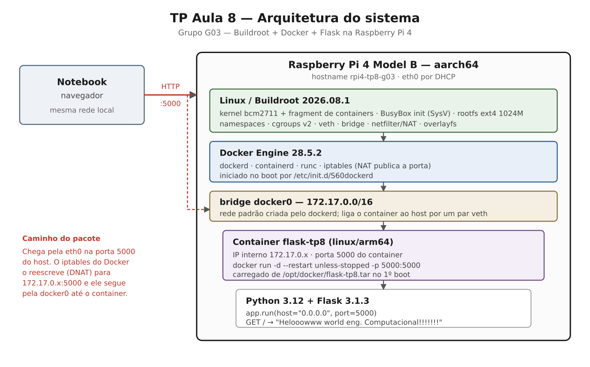

# TP Aula 8 — Buildroot + Docker + Flask na Raspberry Pi 4

**Disciplina:** Sistemas Embarcados · Engenharia de Computação · UNISANTA

**Professor:** Sergio Schina · Grupo 3

| Integrante      | RA     |
|-----------------|--------|
| Pedro Cretella  | 226013 |
| Pedro Brito     | 226146 |
| Vinícius Regis  | 230610 |
| Rafael Lima     | 226326 |

## Objetivo

Construir, com o Buildroot, uma imagem Linux embarcada para a Raspberry Pi 4 que, ao ser ligada,
inicie o sistema, permita login com o usuário configurado durante o build, suba o Docker
automaticamente, carregue um container Flask embarcado na própria imagem e publique a aplicação em
`http://IP_DA_RASPBERRY:5000`, respondendo:

```
Helooowww world eng. Computacional!!!!!!!
```

Tudo isso **sem nenhum comando manual** após o boot e **sem acesso à internet**: a imagem do
container viaja dentro do cartão.

## Hardware utilizado

| Item | Descrição |
|---|---|
| Placa | Raspberry Pi 4 Model B |
| SoC | Broadcom BCM2711, Cortex-A72 quad-core, AArch64 |
| Armazenamento | cartão microSD (mínimo 2 GB; a imagem ocupa 1,1 GB) |
| Rede | Ethernet (`eth0`) ligada ao mesmo roteador do notebook, com DHCP |
| Console | monitor HDMI e teclado USB (o banner e o login são evidência visual) |
| Host de build | PC x86_64 com Linux, ~30 GB livres, Docker e emulação ARM64 |

## Versões

| Item | Valor |
|---|---|
| Buildroot | **2026.08.1** |
| Defconfig base | `raspberrypi4_64_defconfig` |
| Arquitetura | AArch64 (Cortex-A72), toolchain externa Bootlin glibc |
| Kernel | Raspberry Pi Linux (`bcm2711_defconfig`) + `linux-docker.fragment` |
| Init | BusyBox init (SysV) |
| Docker | docker-engine 28.5.2 + docker-cli 28.5.2 (pacotes Buildroot) |
| Container | `flask-tp8:1.0` · `linux/arm64` · base `python:3.12.15-slim-bookworm` |
| Aplicação | Flask 3.1.3 sobre Python 3.12 |
| Rootfs | ext4, 1024 MB |

## Arquitetura do sistema



O notebook acessa a aplicação pelo **IP da Raspberry** na porta 5000. O `iptables` que o Docker
gerencia reescreve o destino do pacote (DNAT) para o IP interno do container, na faixa
`172.17.0.0/16` da bridge `docker0`, que não existe fora da placa. A explicação completa está em
[docs/05-rede.md](docs/05-rede.md).

A sequência de boot está em [docs/imagens/02-boot.png](docs/imagens/02-boot.png) e detalhada em
[docs/01-arquitetura.md](docs/01-arquitetura.md).

## Documentação técnica

| Documento | Assunto |
|---|---|
| [docs/01-arquitetura.md](docs/01-arquitetura.md) | camadas do sistema, boot, decisões estruturais |
| [docs/02-buildroot.md](docs/02-buildroot.md) | cada opção do Buildroot: símbolo, motivo, dependências, impacto |
| [docs/03-linux.md](docs/03-linux.md) | fragment de kernel para containers |
| [docs/04-docker.md](docs/04-docker.md) | Docker na imagem e inicialização automática |
| [docs/05-rede.md](docs/05-rede.md) | `docker0`, bridge, veth, `-p 5000:5000` |
| [docs/06-compilacao.md](docs/06-compilacao.md) | reconstrução do zero, tempos, conferências |
| [docs/07-testes.md](docs/07-testes.md) | procedimento de teste e evidências |

## Estrutura do repositório

```
tp8.env                                 parâmetros do grupo (hostname, usuário, senhas, integrantes)
VERSION                                 identificação da versão entregue (gerado)
README.md                               este documento
docs/                                   documentação técnica e diagramas
buildroot-config/                       cópia da defconfig (gerada) + README
evidence/                               evidências da validação
├── login/ docker/ network/ web/        capturas da Raspberry e do navegador
├── build/                              conferências feitas pelos scripts no host
└── hashes.txt                          SHA-256 dos artefatos entregues
br2-external/                           árvore BR2_EXTERNAL (name: TP8)
├── external.desc · Config.in · external.mk
├── configs/tp8_rpi4_defconfig          configuração Buildroot do TP (canônica)
└── board/tp8/rpi4/
    ├── buildroot.fragment              opções do TP sobre a defconfig da Pi
    ├── identidade.fragment             hostname e senha de root (gerado do tp8.env)
    ├── linux-docker.fragment           opções de kernel para containers
    ├── users_table.txt                 usuário do projeto (gerado do tp8.env)
    └── rootfs-overlay/
        ├── etc/issue                   banner exibido antes do login
        ├── etc/init.d/S99flask-tp8     sobe o container no boot
        ├── etc/network/interfaces      eth0 por DHCP
        ├── opt/docker/                 recebe o flask-tp8.tar (fora do Git)
        └── usr/bin/tp8-evidencias      coleta as evidências na própria Pi
flask-app/                              aplicação e Dockerfile
scripts/                                automação do build (00 a 05 + lib.sh)
```

A organização difere do esqueleto sugerido no enunciado em dois pontos, ambos permitidos pela
cláusula de adaptação: o board fica em `board/tp8/rpi4/` e o overlay chama-se `rootfs-overlay/`,
que são os caminhos usados pelo guia da Aula 10; e os scripts são seis em vez de três, um por
etapa do processo.

### O que não é versionado

| Fora do Git | Motivo |
|---|---|
| `buildroot/`, `output-rpi4/`, `*.img` | artefatos de build, reconstruídos pelos scripts |
| `flask-tp8.tar` (48 MB) | artefato de build; o que o define (`Dockerfile`, `app.py`, `requirements.txt`) está versionado |

O SHA-256 de ambos os artefatos fica em [evidence/hashes.txt](evidence/hashes.txt). Build de Docker
não é reprodutível byte a byte, então o hash identifica o artefato **entregue**, não valida uma
reconstrução.

## Procedimento de configuração

Todo parâmetro do grupo está no `tp8.env`:

```sh
GRUPO="G03"
INTEGRANTES=( "Pedro Cretella - RA 226013" ... )
HOSTNAME_RPI="rpi4-tp8-g03"
USUARIO="aluno"
SENHA="tp8grupo03"
ROOT_SENHA="123456"
BUILDROOT_VERSION="2026.08.1"
VERSAO_PROJETO="1.0"
```

Depois de editar, `./scripts/02-configure.sh` regenera o `/etc/issue`, o `users_table.txt`, o
`identidade.fragment`, o `VERSION` e a defconfig — e falha se recarregar a defconfig salva não
reproduzir o mesmo `.config`.

## Procedimento de compilação

```bash
./scripts/00-setup-host.sh        # dependências, Docker, buildx, emulação arm64 (usa sudo)
./scripts/01-fetch-buildroot.sh   # Buildroot 2026.08.1 em ./buildroot
./scripts/02-configure.sh         # gera e salva br2-external/configs/tp8_rpi4_defconfig
./scripts/03-build-flask-image.sh # imagem arm64 → rootfs-overlay/opt/docker/flask-tp8.tar
./scripts/04-build-image.sh       # make → output-rpi4/images/sdcard.img
```

Os scripts `02` e `03` podem rodar em qualquer ordem entre si, mas os dois precisam rodar antes do
`04`. Equivalente manual:

```bash
cd buildroot
make O=../output-rpi4 BR2_EXTERNAL=../br2-external tp8_rpi4_defconfig
make O=../output-rpi4 BR2_EXTERNAL=../br2-external -j$(nproc)
```

Primeiro build: cerca de 30 minutos em 20 núcleos. Rebuild incremental após mudar o overlay: menos
de um minuto. Detalhes em [docs/06-compilacao.md](docs/06-compilacao.md).

## Procedimento de gravação do microSD

```bash
./scripts/05-flash-sd.sh
```

O script lista os discos, pede o nome do dispositivo, recusa o disco do sistema e qualquer
dispositivo maior que 256 GB, exige a digitação do nome uma segunda vez e só então executa o `dd`.
Também se recusa a gravar uma imagem que não contenha o tar do container.

Alternativa gráfica: Raspberry Pi Imager ou balenaEtcher, escolhendo `output-rpi4/images/sdcard.img`
como imagem personalizada.

Equivalente manual, para quem preferir:

```bash
sudo dd if=output-rpi4/images/sdcard.img of=/dev/sdX bs=4M status=progress conv=fsync
sync
```

## Usuário configurado

| Usuário | Senha | Grupos | Como nasce |
|---|---|---|---|
| `aluno` | `tp8grupo03` | `aluno`, `docker` | `users_table.txt` → `/etc/passwd`, `/etc/shadow` (SHA-256), `/etc/group` |
| `root` | `123456` | — | `BR2_TARGET_GENERIC_ROOT_PASSWD` |

Linha da users table:

```
aluno -2 aluno -2 =tp8grupo03 /home/aluno /bin/sh docker Aluno_TP8_G03
```

O `-2` pede UID e GID automáticos na faixa de usuário comum (1000 em diante); o `=` indica senha em
texto claro, que o `mkusers` converte em hash — aceitável apenas neste TP. Pertencer ao grupo
`docker` é o que permite ao `aluno` usar a CLI sem `root`.

## Como iniciar o sistema

1. Cartão gravado no slot da Raspberry.
2. Cabo Ethernet no mesmo roteador do notebook.
3. Monitor HDMI e teclado.
4. Fonte de alimentação **por último**.

Ao ligar, o banner do grupo aparece antes do `login:`. Entre com `aluno` / `tp8grupo03`.

> **No primeiro boot, a tela fica parada por 1 a 2 minutos** na mensagem
> `[TP8] carregando imagem Docker`. É o `docker load` dos 48 MB do cartão, que acontece uma única
> vez. Não desligue a placa nesse momento. Nos boots seguintes o login aparece normalmente.

## Como descobrir o IP da Raspberry

```sh
ip addr show eth0
```

O endereço aparece na linha `inet`, algo como `192.168.0.42/24`. Alternativas: `ip route`, ou a
lista de clientes DHCP na interface do roteador. O `tp8-evidencias` imprime a URL pronta ao final.

## Como verificar o Docker

```sh
docker version     # cliente e daemon respondendo
docker info        # estado do daemon; avisos de kernel apareceriam aqui
docker images      # flask-tp8:1.0 deve estar listada
```

## Como verificar o container

```sh
docker ps                      # flask-tp8 deve estar "Up"
docker network ls              # a rede bridge (docker0)
docker inspect flask-tp8       # IP interno e publicação da porta
docker logs flask-tp8          # saída do Flask
```

## Como acessar a aplicação

Na própria Raspberry:

```sh
curl http://127.0.0.1:5000
```

Do notebook, na mesma rede local, no navegador:

```
http://IP_DA_RASPBERRY:5000
```

Os dois devem exibir `Helooowww world eng. Computacional!!!!!!!`.

## Procedimentos de teste

Após o login, rode na placa:

```sh
tp8-evidencias
```

Ele coleta `hostname`, `whoami`, `id`, `uname -a`, `/etc/issue`, `ip addr`, `ip route`,
`docker version`, `docker info`, `docker images`, `docker ps -a`, `docker network ls`,
`docker inspect flask-tp8`, o SHA-256 do tar e o `curl` local, gravando tudo em
`~/evidencias-tp8.txt`.

**Teste de reinicialização:** três ciclos de `reboot`, sem executar nenhum comando Docker à mão. A
cada boot, repetir `tp8-evidencias` e o acesso pelo navegador. O arquivo acumula as execuções. O
objetivo é comprovar que o serviço e o container voltam sozinhos.

Procedimento completo e tabela de diagnóstico por sintoma em [docs/07-testes.md](docs/07-testes.md).

## Evidências

Em [evidence/](evidence/): capturas do banner e do login, saídas dos comandos acima, print do
navegador do notebook e os SHA-256 dos artefatos. As conferências que os scripts fazem no host
ficam em [evidence/build/](evidence/build/):

- [usuarios-na-imagem.txt](evidence/build/usuarios-na-imagem.txt) — `/etc/passwd` e `/etc/group`
  lidos de dentro do `rootfs.ext4` com `debugfs`;
- [kernel-check-config.txt](evidence/build/kernel-check-config.txt) — o `check-config.sh` do
  próprio Docker rodado contra o `.config` do kernel gerado.

## Problemas encontrados e soluções adotadas

### Previstos e tratados desde o início

| Problema | Solução |
|---|---|
| rootfs padrão da Pi tem 120 MB, insuficiente para Docker | `BR2_TARGET_ROOTFS_EXT2_SIZE="1024M"` |
| Host x86_64 geraria imagem amd64 → `exec format error` na Pi | `docker buildx --platform linux/arm64` e checagem de `arm64/linux` no script 03 |
| O `S99` podia rodar antes de o `dockerd` responder | laço de espera em `docker info`, até 60 tentativas |
| Arquivos editados com CRLF quebram scripts `#!/bin/sh` | o script 02 normaliza finais de linha e permissões antes do build |

### Falharam na prática, no host do grupo

| Problema | Solução |
|---|---|
| O `00-setup-host.sh` era só `apt-get` e morria no host Arch do grupo | passou a detectar `apt-get`/`pacman`; no Arch instala `base-devel` e `docker-buildx` e ativa o `docker.service`, que lá não vem habilitado |
| A árvore extraída como `buildroot-2026.08.1/` não casava com o caminho `buildroot/` esperado pelos scripts, e o `.gitignore` não a cobria | pasta renomeada, versão fixada no `tp8.env` e padrão acrescentado ao `.gitignore` |
| O padrão `buildroot-*/` do `.gitignore` passou a esconder o diretório `buildroot-config/` | padrão restringido para `buildroot-20*/` |

### Encontrados em revisão, antes de quebrarem

Todos eram falhas que só apareceriam com a Raspberry na mesa, depois de horas de build.

| Problema | Solução |
|---|---|
| O `/etc/network/interfaces` do overlay tinha só duas diretivas. Como o overlay é copiado **depois** dos pacotes, ele sobrescrevia o arquivo gerado pelo `BR2_SYSTEM_DHCP` e perdia o `wait-delay 15` — sem essa espera o `udhcpc` pode rodar antes de o link subir e a `eth0` fica sem IP | o arquivo do overlay passou a conter as quatro diretivas completas, idênticas às geradas; o script 04 confere o `wait-delay` no rootfs final |
| O script 04 procurava o usuário em `output-rpi4/target/etc/passwd`, mas o `mkusers` roda sob fakeroot numa **cópia** do target, apagada após gerar a imagem. A checagem falharia sempre, no fim do build | o 04 passou a ler `/etc/passwd` e `/etc/group` de dentro de `images/rootfs.ext4` com `debugfs`, conferindo o artefato real |
| O host de build roda Docker 29 e a Pi roda 28.5.2. O `buildx` acrescenta manifests de atestação por padrão, e o `docker load` da Pi poderia recusar o tar | `--provenance=false --sbom=false` e checagem de `manifest.json` na raiz do tar |
| Opções do fragment de kernel com dependência não satisfeita são descartadas em silêncio pelo kconfig — só apareceriam como `WARNING` no `docker info`, já na Pi | o script 04 roda o `check-config.sh` do Docker contra o `.config` gerado e falha se faltar algo obrigatório |
| O `CONFIG_BRIDGE=y` foi rebaixado para `=m`: ele tem `depends on IPV6 \|\| IPV6=n` e o `bcm2711_defconfig` traz `CONFIG_IPV6=m` | mantido como módulo, que é seguro: o alvo tem `kmod`, o `depmod` roda no build e o `check-config.sh` aceita *as module*. Documentado no fragment |
| O `docker load` extrai as camadas no mesmo ext4 de 1024 MB, e nada verificava o espaço livre | o script 04 compara o espaço livre com o tamanho do tar e avisa |

## Limitações conhecidas

- **Validação em hardware pendente.** A imagem foi verificada por inspeção do artefato gerado —
  usuário, grupo, banner, rede, scripts de init e tar do container lidos de dentro do
  `rootfs.ext4`, e kernel aprovado no `check-config.sh` do Docker. O boot numa Raspberry física e
  os três ciclos de reboot ainda não foram executados, e as pastas de `evidence/` estão vazias.
- **Senhas em texto claro** no `tp8.env` e, por consequência, no repositório. Aceitável apenas
  neste TP, como o próprio enunciado indica; um produto real usaria hash e provisionamento.
- **A interface `eth0` aparece em dois lugares** — no `BR2_SYSTEM_DHCP` e escrita à mão no
  `interfaces` do overlay. Hoje concordam, mas trocar só um dos dois não teria efeito, porque o
  overlay sobrescreve.
- **O `BR2_TARGET_GENERIC_ISSUE` é inerte.** O banner real vem do overlay, que é copiado depois. A
  variável é mantida porque o enunciado pede o hostname e o issue configurados no `menuconfig`.
- **Build de Docker não é reprodutível byte a byte**, então reconstruir o projeto gera uma imagem
  funcionalmente equivalente, mas com outro SHA-256.
- **O primeiro boot é lento** e aparenta travamento durante o `docker load`.
- **Não há compilador no alvo.** Incluir o Go foi cogitado e descartado: a instalação ocupa 313 MB,
  contra 258 MB que o sistema inteiro usa hoje. Programas para esta placa devem ser compilados de
  forma cruzada no PC, com alvo AArch64 / Cortex-A72. O raciocínio completo está em
  [docs/02-buildroot.md](docs/02-buildroot.md).

## Versão final entregue

| Item | Valor |
|---|---|
| Versão do projeto | 1.0 |
| Branch | `main` |
| Tag | `tp8-final` |
| Buildroot | 2026.08.1 |
| Hostname | `rpi4-tp8-g03` |
| Usuário | `aluno` |
| URL esperada | `http://IP_DA_RASPBERRY:5000` |
| SHA-256 do `flask-tp8.tar` | `a95183335b829030b610fd6bbd9cef293ebe80f4e2962cceea5fba7eba3e99a6` |
| SHA-256 do `sdcard.img` | `ba2485d8759abef375e43975ec23b5e63de7f1077d2f83cd276f03c030cfab13` |

O arquivo [VERSION](VERSION) registra os mesmos dados, gerado a partir do `tp8.env`.
