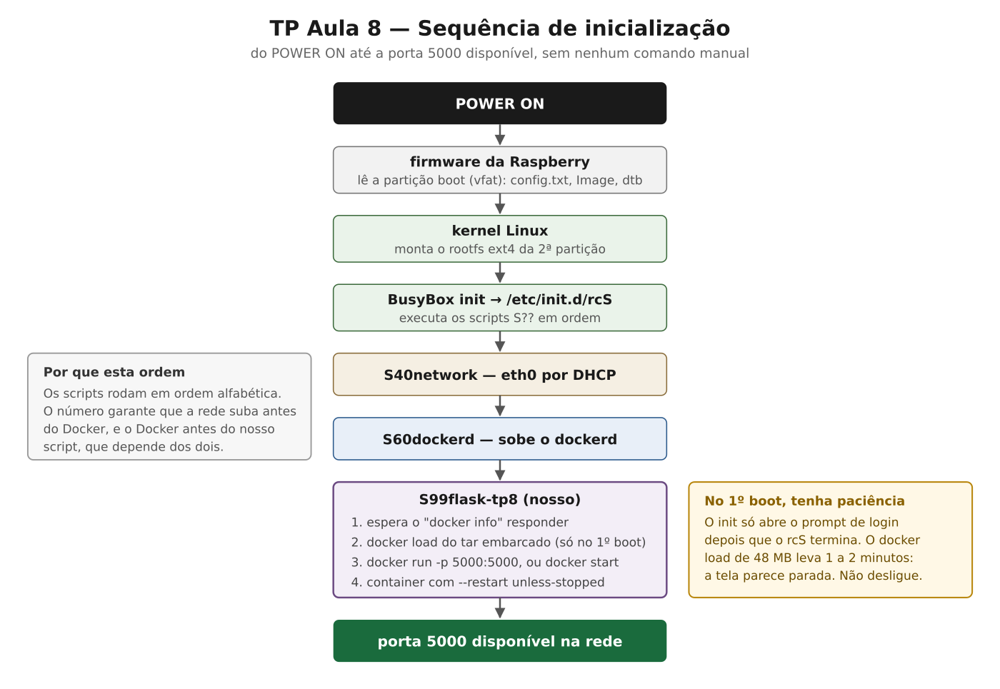

# 01 — Arquitetura do sistema

## As camadas, de baixo para cima

| Camada | O que é | Onde é definida no repositório |
|---|---|---|
| Hardware | Raspberry Pi 4 Model B, SoC BCM2711, Cortex-A72 (aarch64) | `raspberrypi4_64_defconfig` |
| Kernel | Raspberry Pi Linux, `bcm2711_defconfig` + fragment de containers | `board/tp8/rpi4/linux-docker.fragment` |
| Userspace | rootfs ext4 de 1024 MB gerado pelo Buildroot, BusyBox init (SysV) | `board/tp8/rpi4/buildroot.fragment` |
| Identidade | hostname, `/etc/issue`, usuário `aluno`, senha de root | `tp8.env` → `identidade.fragment`, `users_table.txt`, overlay |
| Docker | `dockerd`, `containerd`, `runc`, `iptables` | `BR2_PACKAGE_DOCKER_ENGINE`, `BR2_PACKAGE_DOCKER_CLI` |
| Container | `flask-tp8:1.0`, `linux/arm64`, base `python:3.12.15-slim-bookworm` | `flask-app/Dockerfile` |
| Aplicação | Flask 3.1.3 escutando em `0.0.0.0:5000` | `flask-app/app.py` |

O ponto central: **o container não tem kernel próprio**. Ele carrega o user space (Python, Flask,
bibliotecas) mas compartilha o kernel da Raspberry. Daí decorrem duas consequências que organizam
todo o projeto: os binários do container têm que ser AArch64, e o kernel da imagem Buildroot tem
que ter os recursos que containers exigem. Ver [03-linux.md](03-linux.md).

## Sequência de inicialização

O BusyBox init executa `/etc/init.d/rcS`, que roda os scripts `S??*` em ordem alfabética. A
numeração é a dependência: a rede (`S40`) sobe antes do Docker (`S60`), e o Docker antes do nosso
script (`S99`), que precisa dos dois.

## Decisões estruturais

**Tudo que é do produto fica fora da árvore do Buildroot.** A customização vive em
`br2-external/`, declarada por `external.desc` com o nome `TP8`. O Buildroot pode ser apagado e
baixado de novo — como o `scripts/01-fetch-buildroot.sh` faz — sem perder nada do grupo. É também
o que permite ao repositório conter só o que é nosso.

**Arquivos chegam ao sistema pelo overlay, nunca por edição manual.** O `rootfs-overlay/` é
copiado por cima do rootfs no fim do build. Editar `output/target` ou o cartão gravado produz uma
alteração que some no próximo build e que o repositório não reproduz — o PDF do TP chama isso de
falha de reprodutibilidade.

**O sistema funciona sem internet.** A imagem do container vai embarcada como tar em
`/opt/docker/flask-tp8.tar` e é carregada com `docker load` no primeiro boot. Não existe
`docker pull` em nenhum ponto. O custo é um cartão maior e um primeiro boot mais lento.

**Um único arquivo de parâmetros.** Grupo, integrantes, hostname, usuário e senhas ficam no
`tp8.env`. O `scripts/02-configure.sh` gera a partir dele o `/etc/issue`, o `users_table.txt`, o
`identidade.fragment` e o `VERSION`. Assim banner, hostname e usuário não podem divergir entre si.
