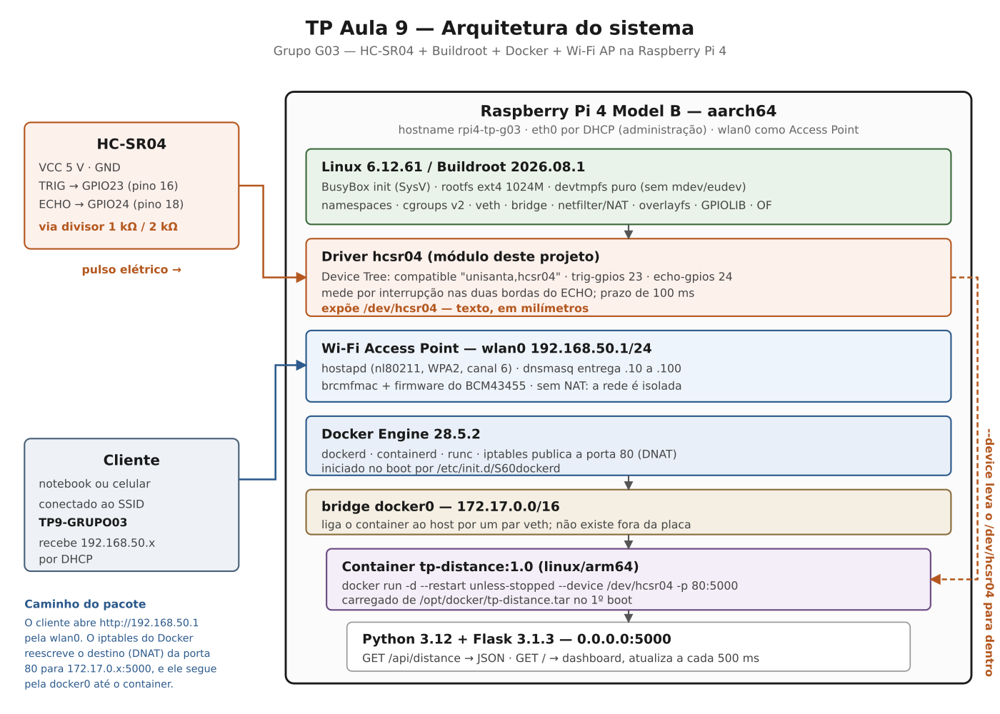
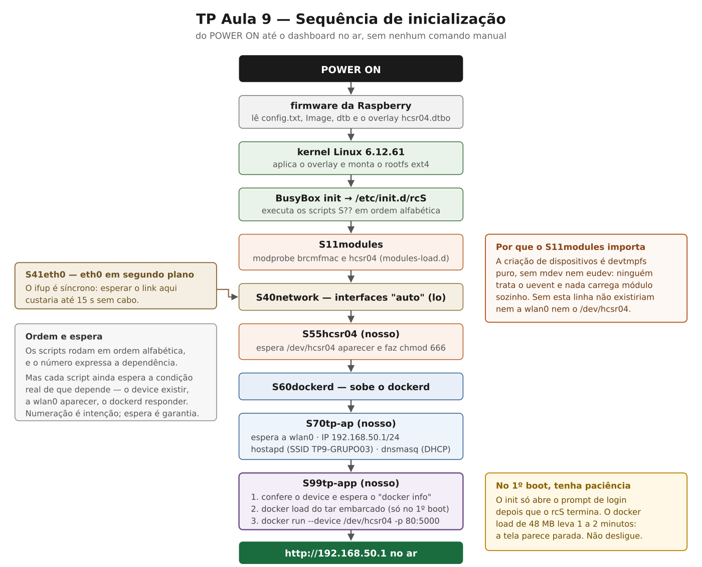

# Arquitetura do sistema



## O caminho de uma medição

Este é o percurso que um número faz, do ar até a tela. Cada seta é uma fronteira entre camadas, e
cada fronteira existe por um motivo.

```
objeto  →  eco ultrassônico
            ↓
         HC-SR04            TRIG = GPIO23, ECHO = GPIO24 via divisor resistivo
            ↓  pulso elétrico
         kernel / driver    interrupção nas duas bordas, Δt → milímetros
            ↓
         /dev/hcsr04        char device, texto: "374\n"
            ↓  --device
         container          Flask lê o arquivo a cada requisição
            ↓  /api/distance
         navegador          busca a cada 500 ms e redesenha o número
            ↑  Wi-Fi
         cliente conectado ao SSID TP9-GRUPO03, em 192.168.50.x
```

É esse caminho que a arguição individual cobra: qualquer integrante deve saber dizer o que
acontece em cada seta e por que a fronteira está ali.

## As camadas, de baixo para cima

| Camada | O que é | Onde é definida no repositório |
|---|---|---|
| Hardware | Raspberry Pi 4 Model B, SoC BCM2711, Cortex-A72 (aarch64) + HC-SR04 | [hardware.md](hardware.md) |
| Device Tree | nó `hcsr04` com `compatible = "unisanta,hcsr04"` e os dois GPIOs | `board/tp/rpi4/hcsr04-overlay.dts` |
| Kernel | Linux 6.12.61 da Raspberry, `bcm2711_defconfig` + fragment de containers | `board/tp/rpi4/linux-docker.fragment` |
| Driver | módulo `hcsr04`, expõe `/dev/hcsr04` | `package/hcsr04-driver/` · [driver.md](driver.md) |
| Userspace | rootfs ext4 de 1024 MB gerado pelo Buildroot, BusyBox init (SysV) | `board/tp/rpi4/buildroot.fragment` |
| Rede | `hostapd` + `dnsmasq` em `wlan0`, 192.168.50.1/24 | [wifi-ap.md](wifi-ap.md) |
| Docker | `dockerd`, `containerd`, `runc`, `iptables` | [docker-web.md](docker-web.md) |
| Container | `tp-distance:1.0`, `linux/arm64`, base `python:3.12.15-slim-bookworm` | `flask-app/Dockerfile` |
| Aplicação | Flask 3.1.3: API e dashboard | `flask-app/` |

Dois pontos organizam todo o resto:

**O container não tem kernel próprio.** Ele traz o user space (Python, Flask, bibliotecas) e
compartilha o kernel da Raspberry. Daí decorrem três consequências: os binários do container têm de
ser AArch64; o kernel precisa dos recursos que containers exigem; e o acesso ao sensor depende de o
device ser **passado para dentro** do container com `--device`, porque o namespace de dispositivos
é separado.

**O hardware fica atrás de um arquivo.** A aplicação não sabe o que é GPIO, interrupção ou
velocidade do som — ela abre `/dev/hcsr04` e lê um número. Trocar o sensor, mudar de pino ou
corrigir o cálculo não altera uma linha de Python. É a finalidade do driver, e é por isso que o
enunciado exige um.

## Sequência de inicialização



O BusyBox init executa `/etc/init.d/rcS`, que roda os scripts `S??*` em ordem alfabética. A
numeração expressa a dependência:

| Script | De onde vem | O que faz |
|---|---|---|
| `S11modules` | Buildroot | `modprobe` do que estiver em `/etc/modules-load.d/` — aqui, `brcmfmac` e `hcsr04` |
| `S40network` | Buildroot | sobe a `lo` |
| `S41eth0` | nosso | dispara o DHCP da `eth0` **em segundo plano** |
| `S55hcsr04` | nosso | espera o `/dev/hcsr04` aparecer e faz `chmod 666` |
| `S60dockerd` | pacote `docker-engine` | sobe o `dockerd` |
| `S70tp-ap` | nosso | `wlan0`, IP estático, `hostapd`, `dnsmasq` |
| `S99tp-app` | nosso | `docker load` no 1º boot, depois `docker run` com `--device` e `-p 80:5000` |

**Sobre a ordem do Wi-Fi e do Docker.** O diagrama do enunciado coloca o Wi-Fi antes do Docker, e a
numeração sugerida pelo próprio guia faz o contrário — `S60dockerd` antes de `S70tp-ap`. Os dois
funcionam, e mantivemos a numeração do guia: a publicação de porta do Docker é uma regra de
`iptables` que vale para interfaces que apareçam depois, e o container só sobe no `S99`, quando as
duas camadas já existem.

**A `eth0` saiu do caminho crítico.** O `ifup` é síncrono: com `auto eth0` no
`/etc/network/interfaces`, o boot inteiro para até o link subir e o DHCP responder — até 15 s
quando não há cabo. Como o acesso normal é pelo Wi-Fi da própria placa, a interface passou a subir
em segundo plano, pelo `S41eth0`. A espera pelo link continua existindo dentro daquele `ifup`; ela
só não atrasa mais o resto.

**Os scripts não confiam só na ordem.** Cada um espera a condição real de que depende — o device
existir, o `dockerd` responder, a `wlan0` aparecer — com prazo e mensagem de erro que diz onde
olhar. Numeração é intenção; espera é garantia.

## Decisões estruturais

**Tudo que é do produto fica fora da árvore do Buildroot.** A customização vive em
`br2-external/`, declarada por `external.desc` com o nome `TP`. O Buildroot pode ser apagado e
baixado de novo — como o `scripts/01-fetch-buildroot.sh` faz — sem perder nada do grupo.

**A nomenclatura não tem número.** A árvore é `br2-external/`, a defconfig é `tp_rpi4_defconfig`, a
imagem do container é `tp-distance:1.0`. O guia prescreve `br2-external-tp9/`, `tp9_rpi4_defconfig`
e `tp9-distance`. A divergência é consciente: o projeto é uma base contínua que atravessa entregas,
e o número no caminho obrigaria a renomear tudo a cada TP, enchendo o histórico de commits de
rename em vez de conteúdo. O que o checklist de avaliação cobra pelo nome — o SSID `TP9-GRUPO03` e
a tag `tp9-final` — mantém o número.

**Arquivos chegam ao sistema pelo overlay, nunca por edição manual.** O `rootfs-overlay/` é copiado
por cima do rootfs no fim do build. Editar `output/target` ou o cartão gravado produz uma alteração
que some no próximo build e que o repositório não reproduz.

**O sistema funciona sem internet.** A imagem do container vai embarcada como tar em
`/opt/docker/tp-distance.tar` e é carregada com `docker load` no primeiro boot; o dashboard não
busca nada de fora — nem fonte, nem biblioteca. Não existe `docker pull` nem CDN em nenhum ponto.
O custo é um cartão maior e um primeiro boot mais lento.

**Um único arquivo de parâmetros.** Grupo, integrantes, hostname, usuário e senhas ficam no
`tp.env`. O `scripts/02-configure.sh` gera a partir dele o `/etc/issue`, o `users_table.txt`, o
`identidade.fragment` e o `VERSION`. Assim banner, hostname e usuário não podem divergir entre si.

**Cada camada tem uma conferência automática no host.** Sem acesso à placa durante o
desenvolvimento, a única defesa contra um erro silencioso é o script de build recusar a imagem.
São conferências de conteúdo do artefato — lidas de dentro do `rootfs.ext4` com `debugfs`, ou
executando os binários aarch64 da imagem por emulação. O que cada uma pega está em
[testes.md](testes.md).
